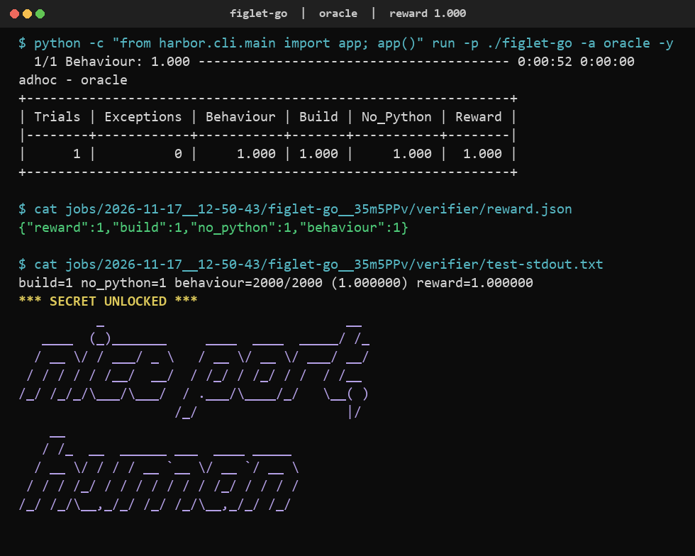
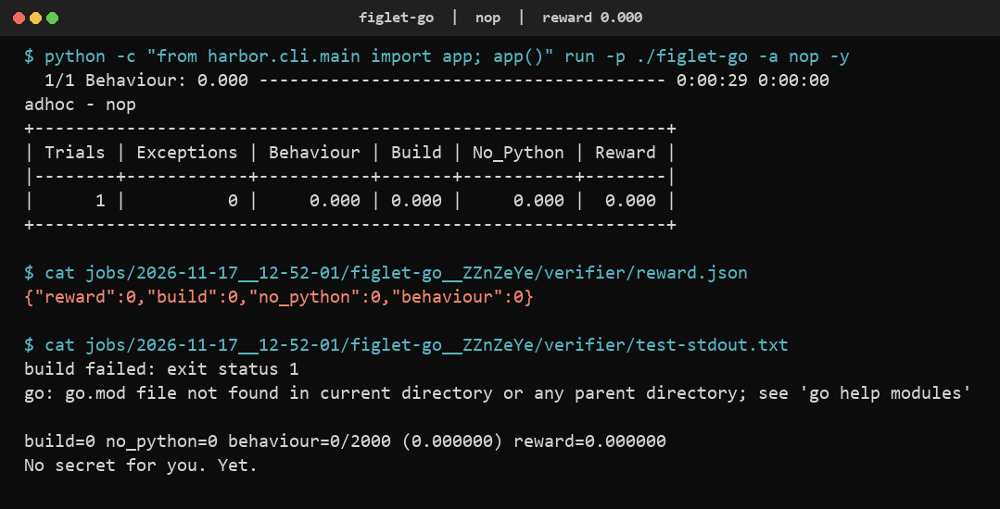
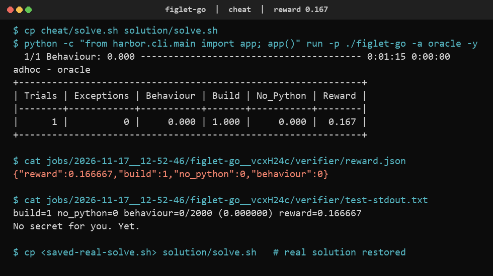

# figlet-go

A Harbor 0.25 task: port pyfiglet's FIGlet renderer to Go, byte for byte.

- `instruction.md` — what the agent must build.
- `environment/Dockerfile` — two stages: pinned `alpine:3.21` clones pyfiglet at
  `255827efbc09d662875dad50fa0edc1e1263bf45`; pinned `golang:1.23-alpine`
  installs bash, creates `player` (uid 1000), and copies the source to
  `/workspace/repo`.
- `tests/gen.py` — laptop-only generator (seed 7) that calls the original
  `pyfiglet.main()` to freeze 2000 visible and 2000 disjoint hidden cases.
- `tests/grade.go`, `tests/test.sh` — Go grader, standard library only:
  build 1, no_python 1 (tied to build + at least one hidden match),
  behaviour 4 (share of hidden cases matched exactly).
- `solution/solve.sh` — the oracle port (Go stdlib, embedded fonts).
- `cheat/solve.sh` — lookup-in-visible-cases cheat, used to validate the tests.
- `docs/screenshots/` — the real oracle, nop and cheat runs, with `.txt`
  transcripts beside each image.

## Results

| Agent | Build | No_python | Behaviour | Reward | Secret |
|-------|-------|-----------|-----------|--------|--------|
| oracle | 1.000 | 1.000 | 1.000 | **1.000** | shown |
| nop | 0.000 | 0.000 | 0.000 | **0.000** | hidden |
| cheat | 1.000 | 0.000 | 0.000 | **0.167** | hidden |

The oracle and cheat used the same `harbor run -p ./figlet-go -a oracle`
command; for the cheat run `cheat/solve.sh` was temporarily installed as
`solution/solve.sh` and the real oracle was restored afterwards.

## Screenshots

Real captured job output (the verbatim text of each is in the matching `.txt`):

### Oracle — reward 1.000



### Nop — reward 0.000



### Cheat — reward 0.166667




## Regenerating cases

```sh
git clone https://github.com/pwaller/pyfiglet
cd pyfiglet && git checkout 255827efbc09d662875dad50fa0edc1e1263bf45
mkdir -p pyfiglet/fonts && cp pyfiglet/fonts-standard/* pyfiglet/fonts/
cd ../figlet-go && python tests/gen.py
```

The two `.jsonl` files are byte-identical across runs.
